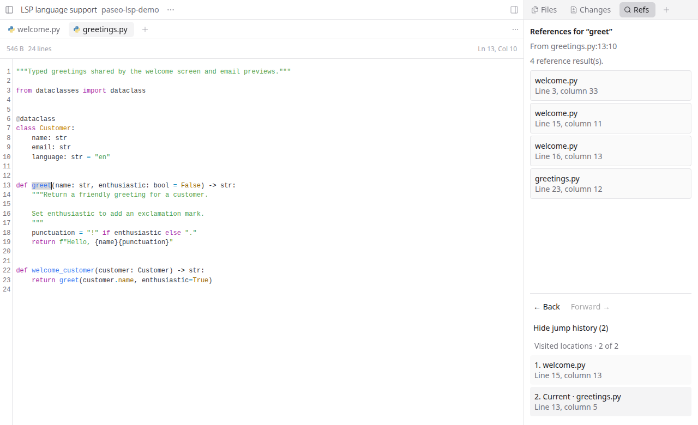

# Paseo plugins

Paseo plugins live under `plugins/`.

## Development

```sh
cd plugins/<plugin>
npm install
npm run typecheck
npm test
paseo plugin install .
```

## Agent keep-awake

`agent-keep-awake` prevents system sleep while any agent turn is running. It uses
`caffeinate` on macOS, `systemd-inhibit` on Linux, and `SetThreadExecutionState` through
PowerShell on Windows.

Install:

```shell
paseo plugin install https://github.com/emosenkis/paseo-plugins.git:plugins/agent-keep-awake
```

## LSP

Code navigation, autocomplete, and symbol rename for Paseo's file editor. See [the plugin overview](plugins/lsp/OVERVIEW.md)
for configuration and supported language servers.
See [example configurations](plugins/lsp/examples/README.md) for a ready-to-use TypeScript setup.
Use **Restart LSP servers** in the Command Center after changing server tooling.



More screenshots: [autocomplete](plugins/lsp/assets/screenshots/autocomplete.png),
[diagnostics](plugins/lsp/assets/screenshots/diagnostics.png),
[hover documentation](plugins/lsp/assets/screenshots/hover.png),
[signature help](plugins/lsp/assets/screenshots/signature.png),
[rename review](plugins/lsp/assets/screenshots/rename.png), and
[restart servers](plugins/lsp/assets/screenshots/restart.png).

This checkout's `.paseo/lsp.json` launches the latest TypeScript and Python language servers
through `pnpx`. Install pnpm on the daemon host; pnpx downloads the packages on first use.
The TypeScript server uses the latest TypeScript 6 release because TypeScript 7 no longer
ships the `tsserver` it requires. The explicit `tsserver` path resolves from pnpx's environment.

Synced from [Covered-Health/paseo-plugins](https://github.com/Covered-Health/paseo-plugins) through
`484d095450a275f9589d73996f4961bb2d636aaa`. Copyright (c) 2026 Protego Health; MIT licensed.

```shell
paseo plugin install https://github.com/emosenkis/paseo-plugins.git:plugins/lsp
```

### Updating from upstream

The original upstream revision is recorded as a merge ancestor. Both repositories use
`plugins/lsp/`, so ordinary merges preserve the directory layout and our local changes.
On a fresh clone, add the remote once:

```sh
git remote add upstream https://github.com/Covered-Health/paseo-plugins.git
```

Then update with:

```sh
git fetch upstream main
git merge upstream/main
```

Review the merge before pushing: it includes upstream changes across the repository,
including any new plugins. Keep our install hardening, packaged license, and example
configurations when resolving conflicts. The LSP build explicitly generates the
autocomplete source after installing locked dependencies with lifecycle scripts disabled.
Run `npm ci`, `npm test`, and `npm run typecheck` in `plugins/lsp/` after merging.
